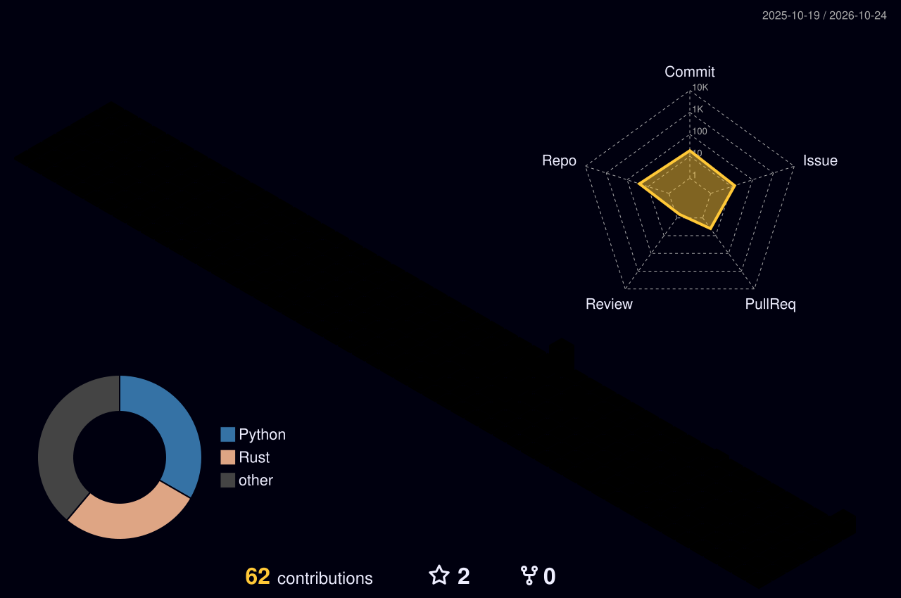
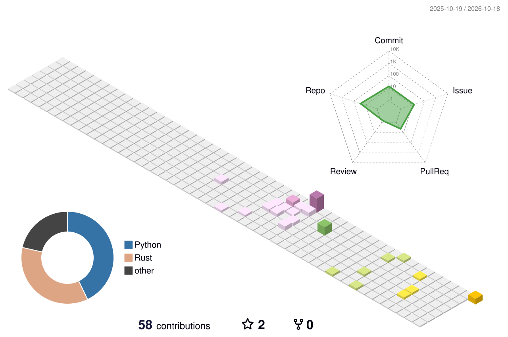

<!-- 🌐 赛博朋克配色版 GitHub 主页
     部署时把本文件重命名为 README.md 覆盖即可
     配色：暗夜紫底 #0d0221 / #050a0e + 霓虹粉 #ff2a6d + 电光青 #05d9e8 + 警示黄 #f9f871 -->

<div align="center">
  
</div>

<div align="center">
  <a href="https://git.io/typing-svg">
    
  </a>
</div>

<p align="center">
  
  <a href="https://github.com/gaoyu666?tab=followers">
    
  </a>
  <a href="https://github.com/gaoyu666?tab=repositories&sort=stargazers">
    
  </a>
</p>

---

## 🧬 About Me

```yaml
name: gaoyu666
role: FDE / AI 解决方案架构师
location: 中国
education: 计算机专业
languages: [Java, Python, TypeScript]
now_focus: [AI Agent 平台, RAG 问答, 桌面智能体]
philosophy: >
  FDE 的价值不止于写代码，
  更在于听懂客户没说出口的那句话。
```

```python
while alive:
    learn()          # 计算机专业底子，代码一直没放下
    build()          # 落地 RAG 问答、桌面智能体、AI Agent 平台
    deliver()        # 金融行业 4 年，方案 -> 交付 -> 上线
```

---

## 🛠️ Tech Stack

<p align="center">
  
</p>

---

## 🔥 3D Contribution Calendar

> 由 GitHub Actions 每日自动生成 · yoshi389111/github-profile-3d-contrib

<p align="center">
  
  <br />
  
</p>

---

## 🐍 Snake Eating My Contributions

> 🟩⬜ 贪吃蛇每天把贡献格子吃一遍 · Platane/snk（自动适配浅色/深色模式）

<p align="center">
  <picture>
    <source media="(prefers-color-scheme: dark)" srcset="./dist/github-snake-dark.svg" />
    <source media="(prefers-color-scheme: light)" srcset="./dist/github-snake.svg" />
    
  </picture>
</p>

---

## 📊 GitHub Stats

<p align="center">
  
  
</p>

<p align="center">
  
</p>

---

## 🏆 Trophy Room

<p align="center">
  
</p>

---

## 📈 Activity Graph

<p align="center">
  
</p>

---

## 🧮 Metrics Infographic

> 全景数据大图 · lowlighter/metrics（Actions 每日生成）


---

## 🎲 Random Dev Quote

<p align="center">
  
</p>

---

## 🤝 联系我

<!-- TODO: 改成你的真实信息 -->
<p align="center">
  <a href="mailto:your-email@example.com"></a>
  <a href="https://github.com/gaoyu666"></a>
  <!-- TODO: 有博客/公众号/知乎把下面这行注释解开并改链接 -->
  <!-- <a href="https://your-blog.com"></a> -->
</p>

<div align="center">
  
</div>
